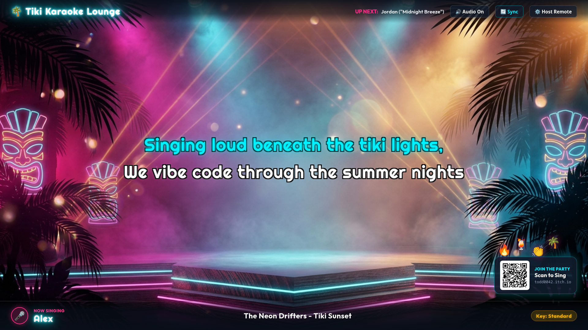
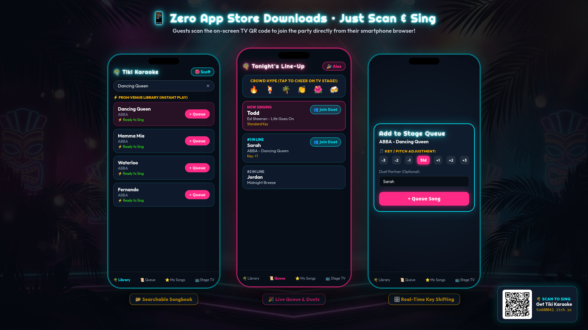
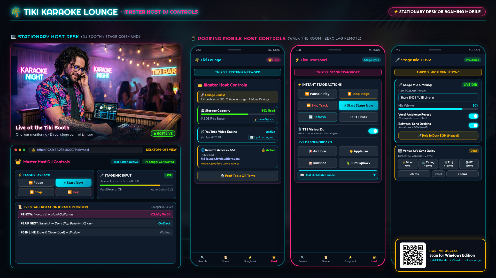

# 🌴 Tiki Karaoke Lounge 🌺
### Turnkey Dual-Screen Karaoke & Party Entertainment System for Windows & Linux

  

  
  
  
  

  <strong>Transform any TV and living room into a high-energy retro tiki karaoke lounge in seconds!</strong> 
  No subscriptions. No clunky software. No awkward dead silence between songs. 
  Plug your PC or handheld into your TV, have everyone scan the QR code with their phones, and sing!

  <a href="https://todd0042.itch.io/tiki-karaoke-lounge">
    <strong>👉 Click Here to Get Tiki Karaoke Lounge on itch.io 👈</strong>
  </a>

---

## ✨ Key Features

### 📱 Smartphone Joining (Zero App Store Downloads)
- **Zero Friction**: Guests scan the on-screen TV QR code with their phone cameras.
- **Instant Web App**: Runs directly in their mobile browser with no App Store or Google Play downloads required.
- **Custom Singer Profiles**: Guests pick a tropical avatar (🌺, 🌴, 🍹, 🦜, 🏄) and enter their name.
- **Smart Queueing**: Search downloaded songs, request duets, adjust pitch/key, and see live queue position in real time.

### 📺 Cinematic Dual-Display TV Stage
- **Automatic HDMI Detection**: Connect your TV or projector; Tiki Karaoke automatically handles dual screens.
- **Synchronized Scrolling Lyrics**: Full-screen, borderless stage display with retro synthwave aesthetics.
- **Crowd Reactions**: Guests tap emojis (🔥, 🍹, 🌴, 👏, 🌺, 🍻) on their phones that float live across the main TV stage.
- **Always-On QR Overlay**: New guests can walk in and scan to join at any point during the party.

### 👑 Private Host DJ Desk (Untethered on Your Phone or Laptop)
- **Roam the Party**: Run the entire show from your smartphone while mingling with guests.
- **Live Queue Moderation**: Reorder, pause, restart, or skip tracks on the fly.
- **Live Stage Microphone & Mixing**: Hardware mic input selector, master mic toggle, warm plate room reverb, and automatic between-song ducking.
- **Studio Soundboard**: Instant live crowd sound effects (Airhorn, Applause, Rimshot, Tropical Bird).
- **Venue A/V Delay Calibration**: Direct steppers and presets (`Direct 0ms`, `TV Lag +80ms`, `Projector +140ms`, `Bluetooth -150ms`) to eliminate HDMI audio delay.

### 🎬 Intelligent Intermission Autopilot
- **Never Dead Silence**: When the queue runs empty, Tiki Karaoke keeps the party energy alive automatically.
- **🎤 Sing-Along Autopilot**: Automatically plays popular crowd sing-along videos with guide vocals.
- **📼 Music Video Filler**: Rotates official music videos from your local crate.
- **🌴 Procedural Synth BGM**: Built-in ambient tropical synthwave tracks with intelligent ducking.

### 🎛️ Real-Time Pitch & Key Shifting
- Transpose any song **±6 semitones** in real time using high-fidelity Web Audio DSP.
- Perfect for singers looking to match their natural vocal range without altering playback speed.

---

## 📸 Screenshots & Showcase

### 1. Main Stage TV Display (1080p)
*Cinematic full-screen lyrics with Up Next tickers and crowd hype reactions.*

  

### 2. Guest Mobile Experience (Zero Install)
*Searchable songbook, live queue rotation, crowd hype emojis, and real-time key transposition.*

  

### 3. Master Host DJ Controls (Stationary Laptop + Roaming Mobile)
*Full stationary command desk at the DJ booth, or untethered 3-way mobile control from any phone.*

  

---

## 📦 Download Packages Available on itch.io

Every purchase grants lifetime access to standalone packages:

| Platform | Format | Description |
| :--- | :--- | :--- |
| **Windows** | `TikiKaraokeSetup-v1.0.0.exe` | One-click turnkey installer with Desktop and Start Menu shortcuts. |
| **Windows** | `TikiKaraoke-Windows-v1.0.0-Portable.zip` | 100% portable zero-install edition. Run from a USB stick on any PC without admin rights. |
| **Linux** | `TikiKaraoke-v1.0.0-x86_64.AppImage` | Universal single-file AppImage. Click-and-run on Ubuntu, Debian, Mint, Fedora, Arch, and SteamOS. |

---

## 🏢 Commercial & Venue Ready

Tiki Karaoke Lounge includes a **Perpetual Single-Seat Commercial License** with every purchase:
- **Commercial Mode Killswitch**: Disables online downloaders and locks search strictly to your legally acquired local songbook.
- **In-App Rights & Compliance Directory (`/legal`)**: Comprehensive guidance on authorized karaoke track vendors and PRO licensing (ASCAP, BMI, SESAC, PRS, SOCAN).
- **Zero Recurring Fees**: Run bar nights, weddings, private lounges, and mobile DJ gigs without monthly software subscriptions.

---

## ⚖️ Legal Disclaimer

> **Bring Your Own Media (BYOM) Architecture**:  
> Tiki Karaoke Lounge is an independent local media player and event hosting utility. It does not contain, host, sell, or distribute copyrighted sound recordings, musical compositions, or synchronized karaoke media. End users and venue operators are responsible for supplying their own legally acquired media files and maintaining applicable public performance licenses for commercial venue use.

---

## 🔗 Official Links & Community

- 🛒 **Storefront & Downloads**: [https://todd0042.itch.io/tiki-karaoke-lounge](https://todd0042.itch.io/tiki-karaoke-lounge)
- 🌴 **Developed by**: [Todd0042](https://github.com/Todd0042)
